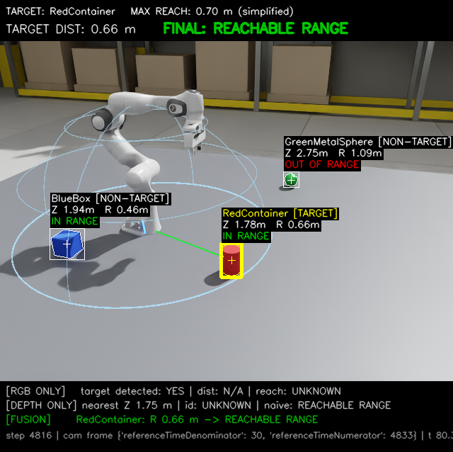
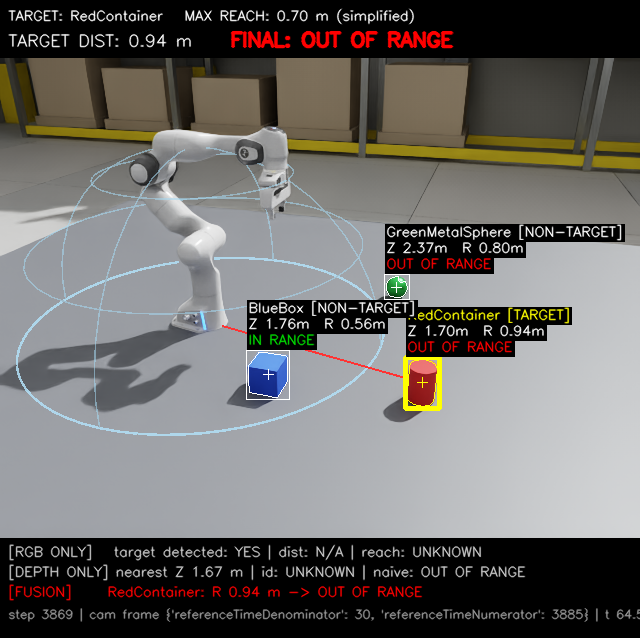

# Task 1 · RGB-D 센서 융합 기반 목표 객체 작업반경 판단

> NVIDIA Isaac Sim 기반 센서 융합으로 주변 환경 인식하기

작업대 위의 여러 물체 중 **빨간 원통(Target)**을 식별하고, 로봇팔이 작업하기 전에 해당 물체가 **로봇 기준 반경 0.70 m 안에 있는지** 판단하는 실험이다. 아래 내용은 [노션 과제 수행 기록](https://app.notion.com/p/NVIDIA-Isaac-Sim-3f399f3a4a0781db9767eb718569d338)을 요약한 것이다. 원문 열람에는 접근 권한이 필요할 수 있다.

## 실험 환경

- **실행 환경:** Linux · Isaac Sim 5.1.0 · Python 3.11 · RTX 5060
- **장면:** 작업대, Franka 로봇팔, 빨간 원통(Target), 파란 상자·초록 구(Non-Target)
- **센서:** 고정형 RGB-D 카메라(eye-to-hand), 640 × 480, 20 Hz
- **범위:** 객체 인식과 거리 기반 판정까지 구현하며, 실제 로봇팔 이동·파지는 수행하지 않음

## 주요 수행 내역

1. **장면 구성:** 로봇팔과 세 객체를 배치하고, 작업대를 어두운 색으로 변경해 시인성을 높였다. 작업대 크기와 카메라 위치도 조정했다.
2. **객체 식별:** RGB 영상을 HSV로 변환하여 객체별 마스크와 중심 픽셀을 검출하고 Target을 구분했다.
3. **센서 융합:** 동일 카메라의 RGB·Depth를 함께 수집하고, 객체 마스크 내부의 유효 Depth 중앙값으로 3D 위치를 추정했다.
4. **작업반경 판단:** Camera → World → Robot Base 좌표변환 후 Target까지의 3D 거리를 0.70 m와 비교했다. Target 미검출과 Depth 무효 상태도 별도로 처리했다.
5. **결과 시각화:** Isaac Sim 내부 RGB-D Fusion Monitor, 작업반경 표시, Target 연결선을 구현하고 이미지·CSV·요약 로그를 저장했다.

```text
RGB → Target 마스크 ─┐
                    ├→ 3D 위치 → World → Robot Base → 거리 → 반경 판정
Depth → 마스크 내 값 ─┘
```

## 실험 결과

세 조건 모두 빨간 원통을 Target으로 지정했다. 노션에 기록된 배치 조건을 로컬 요약 로그와 대조한 결과는 다음과 같다.

| 조건 | 배치 | Target 거리 | 최종 판정 | 기록 |
| --- | --- | ---: | --- | --- |
| 1 | Target과 파란 상자가 반경 안 | 0.659 m | REACHABLE RANGE | [프레임 4816](results/scnA_f004816_summary.txt) |
| 2 | Target은 반경 밖, 파란 상자는 반경 안 | 0.940 m | OUT OF RANGE | [프레임 3869](results/scnA_f003869_summary.txt) |
| 3 | Target과 초록 구가 반경 안 | 0.221 m | REACHABLE RANGE | [프레임 5966](results/scnA_f005966_summary.txt) |

RGB만으로는 실제 3D 거리를 알기 어렵고, Depth만으로는 지정한 물체를 식별하기 어렵다. 두 정보를 결합해 다른 물체의 위치와 구분하여 **Target 기준 작업반경 판단**을 수행했다.

| 조건 1 · 반경 안 | 조건 2 · 반경 밖 |
| --- | --- |
|  |  |

## 파일 구조

```text
task1_sensor_fusion/
├── README.md
├── sensor_fusion_reachability.py   # 장면·센서 융합·판정·시각화 코드
├── results/                       # CSV 1개, RGB 5장, Depth 5장, 요약 5개
│   ├── results.csv
│   ├── scnA_fXXXXXX_annotated_rgb.png
│   ├── scnA_fXXXXXX_depth_vis.png
│   └── scnA_fXXXXXX_summary.txt
└── screenshots/                   # 실행 화면 10장
```

[측정 데이터](results/results.csv) · [전체 결과](results/) · [실행 화면](screenshots/)

## 실행 방법

Linux의 Isaac Sim 설치 폴더에서 저장소 경로를 지정해 실행한다.

```bash
./python.sh /path/to/physicalAI-mobility-simulation/task1_sensor_fusion/sensor_fusion_reachability.py --scenario A --save
```

새 결과는 `task1_sensor_fusion/output/`에 저장된다. 이 폴더는 Git에서 제외되므로 보관할 결과만 `results/`에 옮긴다. 위 실험 조건 1~3은 코드의 초기 배치 프리셋 A/B/C와 별개다.

## 한계 및 개선 방향

0.70 m는 실험용 단순 반경이며 IK·파지·충돌 회피 가능성을 보장하지 않는다. HSV 검출은 조명과 유사 색상에 취약하고, 가림에 따른 위치 오차 및 실제 Depth 노이즈·결측도 추가 검증이 필요하다. 향후 딥러닝 객체 인식, 3D 점군 기반 중심 추정, 노이즈 모델, 다중 카메라 융합으로 확장할 수 있다.
